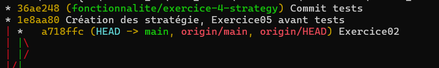

# Décisions

Le patron strategy dans notre cas sert a séparer les trois types de rabais que nous avons. L'interface IStrategieRabais
est celle qui décide laquelle appeler avec chacune leur façon de calculer le rabais. Ensuite CalculateurFacture reçoit une 
stratégie par paramètre et appelle son calcul sans savoir laquelle c'est. Ici, notre code est ouvert a l'extension comparativement
a avant ou il aurait fallu rajouter un if dans calculateurfacture pour chaque nouveau rabais, maintenant il faut juste
faire hériter IStrategieRabais. Pour la composition, nous avons un exemple de la classe StrategieRabaisComposee, qui inclue
deux stratégie au lieu de devoir faire deux calculs différent dans calculateurFacture.
Voici un petit code pour le main:

 IStrategieRabais strategie = new RabaisFidelite();

        CalculateurFacture calculateur = new CalculateurFacture(strategie);

        decimal total = calculateur.CalculerTotal(20m);

        Console.Out.WriteLine("Total : " + total);

    Et voici mon image (je suis sur le meme depot depuis semaine2 2)
